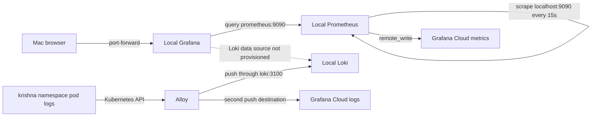

# Kubernetes manifests, database and monitoring notes

Simple revision notes for what we studied: a local website and database, the
purpose of each manifest, monitoring with Prometheus/Grafana/Loki/Alloy, cloud
queries, workload controllers, probes, and volume mounting.

- [Application files and concepts](#files-and-concepts)
- [Deploy and open the application](#deploy)
- [Manifest basics](#understanding-a-manifest)
- [Deployment, StatefulSet and DaemonSet](#deployment-statefulset-and-daemonset)
- [Readiness, liveness and startup probes](#readiness-liveness-and-startup-probes)
- [Volume mounting](#volume-mounting)
- [Monitoring architecture and all 13 files](#monitoring-architecture)
- [Local access and troubleshooting](#open-local-monitoring)
- [Grafana Cloud queries](#queries-for-grafana-cloud)
- [Command revision](#command-revision)
- [Prompts](prompt.txt)

The notes describe the checked-in configuration, not a live cluster health check.
Database passwords and cloud tokens are not included.

## Application architecture

One kind node runs a small Flask website and a PostgreSQL database. This lab uses Docker Desktop on your Mac and does not use AWS.

**Browser → website Service → Flask pod → postgres Service → PostgreSQL → persistent volume**

You can add messages, see them after refreshing the page, and delete them.

## Files and concepts

- `cluster.yaml`: defines the local Kubernetes node.
- `manifests/namespace.yaml`: creates the `krishna` namespace.
- `manifests/database-configmap.yaml`: stores the shared database connection settings.
- `manifests/database-secret.yaml`: stores the password and session key locally; excluded from Git.
- `manifests/database-secret.yaml.example`: safe template for a fresh checkout.
- `manifests/postgres-pvc.yaml`: requests persistent storage for PostgreSQL.
- `manifests/postgres-deployment.yaml`: runs one PostgreSQL pod.
- `manifests/postgres-service.yaml`: gives PostgreSQL an internal address.
- `manifests/website-deployment.yaml`: runs the Flask website pod.
- `manifests/website-service.yaml`: gives the website an internal address.
- `web/app.py`: the page and Python backend, which runs SQL queries.
- `web/Dockerfile`: packages the app with Python and its dependencies.
- `web/requirements.txt`: Python packages installed inside the image.
- `deploy.sh`: builds the image, loads it into kind, applies the Secret YAML, and deploys the app.

A **ConfigMap** holds DB_HOST, DB_PORT, DB_NAME, and DB_USER. A **Secret** holds the generated database password and app session key. The real Secret YAML is excluded from Git; only the example template is committed. A Secret is not automatically encrypted at rest in this basic kind lab.

A **Deployment** maintains pods. A **Service** gives pods a stable internal address. A **PersistentVolumeClaim (PVC)** requests storage that survives pod deletion.

This is a local learning app without sign-in. Its database is internal to the cluster.

## Deploy

Keep Docker Desktop running. Run on your Mac:

```bash
cd /Users/Ayush/Desktop/WEB_RESUME/Kubernets
# Only create the cluster if it does not already exist.
~/.local/bin/kind create cluster --name learning --config cluster.yaml
./deploy.sh
```

To reapply the YAML files after editing them (with your local Secret YAML present):

```bash
kubectl --context kind-learning apply -f manifests/
```

For a fresh checkout, copy `manifests/database-secret.yaml.example` to `manifests/database-secret.yaml` and replace both placeholder values before running `deploy.sh`. Keep the database password unchanged while reusing an initialized database volume: editing a Secret does not change the password already stored in PostgreSQL. `cluster.yaml` stays outside `manifests/` because it is a kind configuration, not an application resource.

## Open the website

```bash
kubectl --context kind-learning -n krishna port-forward service/website 8081:80
```

Keep that terminal running and open **http://localhost:8081**. This uses port 8081 so an old Nginx port-forward on 8080 does not conflict. If the selected website pod is replaced, restart port-forward.

## Inspect the lab

```bash
kubectl --context kind-learning get nodes
kubectl --context kind-learning -n krishna get pods,services,configmaps,pvc
kubectl --context kind-learning -n krishna logs deployment/website
kubectl --context kind-learning -n krishna logs deployment/postgres
```

## Query the database

Open PostgreSQL's SQL terminal inside its pod:

```bash
kubectl --context kind-learning -n krishna exec -it deployment/postgres -- sh -c 'psql -U "$POSTGRES_USER" -d "$POSTGRES_DB"'
```

Inside `psql`, try:

```sql
-- List tables.
\dt

-- Read all saved messages.
SELECT * FROM messages ORDER BY id;

-- Count messages.
SELECT COUNT(*) FROM messages;

-- Add a row; refresh the website to see it.
INSERT INTO messages (name, message) VALUES ('Krishna', 'My first SQL insert');

-- Update that practice row.
UPDATE messages SET message = 'Updated using SQL' WHERE name = 'Krishna' AND message = 'My first SQL insert';

-- Delete that practice row.
DELETE FROM messages WHERE name = 'Krishna' AND message = 'Updated using SQL';

-- Leave the SQL terminal.
\q
```

## Test data persistence

Save a message on the website, then delete the database pod:

```bash
kubectl --context kind-learning -n krishna delete pod -l app=postgres
kubectl --context kind-learning -n krishna rollout status deployment/postgres --timeout=180s
```

Refresh the page after the database is ready. The PVC retains the messages. A brief connection error during database restart is expected: this lab has only one database pod.

The local volume does **not** survive deleting the kind cluster. It is not a backup.

## Scale the website

```bash
kubectl --context kind-learning -n krishna scale deployment website --replicas=2
kubectl --context kind-learning -n krishna get pods -o wide
```

Both website pods use the same database. Keep the PostgreSQL Deployment at one replica for this lab. Applying the manifests returns the website to its declared one replica.

## Understanding a manifest

A **manifest** is a YAML file describing what Kubernetes should maintain.
`kubectl apply -f FILE` sends that desired configuration to the API server.
Controllers keep working toward it; a successful apply does not mean a Pod is ready.

| Field or concept | Simple meaning | Example from this lab |
| --- | --- | --- |
| `apiVersion` | Which API version understands the object. | `apps/v1` for a Deployment. |
| `kind` | What resource to create. | `Deployment`, `Service`, `ConfigMap`. |
| `metadata.name` | The resource's name. | `website`, `postgres`, `alloy`. |
| `metadata.namespace` | The logical group the resource belongs to. | `krishna` or `monitoring`. |
| `spec` | The desired settings. | Replicas, image, volumes and ports. |
| `spec.template` | The Pod definition a workload controller uses. | Container image and environment. |
| Labels | Tags placed on objects. | `app: website` on the website Pod. |
| Selectors | Rules for finding objects by their labels. | The website Service selects `app: website`. |
| `replicas: 1` | Maintain one Pod for this Deployment. | All Deployments in this lab. |
| `containerPort` | Declares the port the container is expected to use. | Flask listens on `8000`; this field alone does not expose it. |
| Service `port` / `targetPort` | Service port / destination container port. | Website Service `80` → Flask `8000`. |
| Requests / limits | Resources requested for scheduling / enforced resource bounds. | Website requests `50m` CPU and `64Mi` memory; memory limit `256Mi`. |

A **cluster** is a group of Kubernetes machines; a **node** is one machine.
The **control plane** manages cluster state and scheduling. Nodes run Pods.
A **Pod** is the smallest deployable unit and contains one or more containers.
A namespace organizes resources; creating one does not create a node.

`cluster.yaml` declares one kind control-plane node. This kind learning node can
also run application Pods. kind's Docker containers are separate from the
Kubernetes cluster managed by Docker Desktop's own Kubernetes feature.

A Deployment replaces lost Pods through its ReplicaSet. A Service is still
needed because replacement Pods can have different IPs: the Service gives
clients a stable address and routes traffic to matching, ready Pods.
ClusterIP means internal cluster access; port-forward provides temporary Mac access.

## Deployment, StatefulSet and DaemonSet

| Type | Simple meaning | Typical use |
| --- | --- | --- |
| Deployment | Keep a chosen number of interchangeable copies running. | Websites, APIs and workers. |
| StatefulSet | Maintain copies with stable identities such as `db-0`, `db-1`. | Database or storage cluster members. |
| DaemonSet | Maintain a copy on every eligible node. | Node log collectors and monitoring agents. |

A StatefulSet can give each Pod its own persistent claim through
`volumeClaimTemplates`; persistence must still be configured. A Deployment can
also mount a PVC. Choosing StatefulSet alone does not make data persistent.

Our website, PostgreSQL, Prometheus, Grafana, Loki and Alloy all use Deployments.
PostgreSQL has one replica, `strategy: Recreate` and a PVC. It is not a StatefulSet.
Do not scale this PostgreSQL Deployment into multiple independent database servers
sharing the same data directory.

Alloy reads logs through the Kubernetes API in our configuration, so a Pod on
every node is not required. Collectors reading node-local container log files
commonly run as a DaemonSet instead.

## Readiness, liveness and startup probes

Probes are health checks Kubernetes runs against a container.

| Probe | Question it asks | What happens after repeated failures? |
| --- | --- | --- |
| Readiness | Can you receive traffic? | The Pod becomes unready and stops receiving normal Service traffic; no restart just for this failure. |
| Liveness | Are you still functioning? | The container is restarted, subject to its restart policy. |
| Startup | Have you finished starting? | The container is restarted if it fails to start within the configured checks. |

When a startup probe is present, readiness and liveness checks wait until it
succeeds. After success, the startup probe stops for that container run.
Checks can use HTTP, an executable command, TCP or supported gRPC health checks.

In our exact manifests:

- Website startup: HTTP `/health` on `8000`, every 5 seconds, failure threshold 60
  (roughly a 5-minute startup allowance).
- Website readiness: HTTP `/health` on `8000`, every 5 seconds. The Flask handler
  executes `SELECT 1`, so this checks database connectivity too.
- PostgreSQL readiness: executes `pg_isready` after an initial 5-second delay,
  then every 5 seconds.
- Loki readiness: HTTP `/ready` on `3100`.
- No liveness probes are configured in the current manifests. We learned the
  concept without adding one.

`periodSeconds` controls check frequency, `initialDelaySeconds` delays the first
check, `timeoutSeconds` bounds a check, and `failureThreshold` sets the number
of consecutive failed checks before the relevant failure action.
See the [Kubernetes probe documentation](https://kubernetes.io/docs/concepts/workloads/pods/probes/).

## Volume mounting

A volume mount makes storage or configuration available at a folder inside a container.

- `volumes`: defines where the data comes from, at Pod level.
- `volumeMounts`: defines where a particular container sees that volume.
- Matching `name` values connect the two definitions.
- `mountPath`: the destination directory inside the container.
- `readOnly: true`: the container cannot write through that mount.

This is the relevant fragment from Loki's Deployment, not a complete manifest:

```yaml
spec:
  template:
    spec:
      containers:
        - name: loki
          volumeMounts:
            - name: config
              mountPath: /etc/loki
              readOnly: true
      volumes:
        - name: config
          configMap:
            name: loki-config
```

```text
ConfigMap loki-config → key loki.yaml → container file /etc/loki/loki.yaml
```

| Volume source | Purpose | Lifetime or example |
| --- | --- | --- |
| ConfigMap | Configuration files. | Loki config at `/etc/loki/loki.yaml`. |
| Secret | Sensitive files or values. | Prometheus cloud token at `/etc/grafana-cloud/token`. |
| `emptyDir` | Temporary Pod storage. | Survives a container restart within the same Pod; removed with that Pod. |
| PVC | Requests persistent storage. | `postgres-data` mounts at `/var/lib/postgresql/data`. |

A **PersistentVolume (PV)** represents storage; a **PersistentVolumeClaim (PVC)**
requests storage for a workload. PostgreSQL's PVC requests `1Gi` and uses
`ReadWriteOnce` (read/write on one node, not necessarily only one Pod).
`PGDATA` points to `/var/lib/postgresql/data/pgdata` inside the mounted volume.
Messages survive database Pod replacement, but deleting this kind cluster
removes its local storage. A PVC is not a backup.

The database ConfigMap and Secret also supply **environment variables**, which
is different from mounting them as files. The website uses `envFrom`; PostgreSQL
uses individual `configMapKeyRef` and `secretKeyRef` entries. Alloy reads its
cloud token from `GRAFANA_LOGS_TOKEN`; Prometheus reads its token from a file.
Changing a ConfigMap or Secret does not refresh environment variables in an
already running container; recreate/restart it to pick up those values.
Mounted file updates and application reload behavior depend on how the app reads them.
See the [Kubernetes volume documentation](https://kubernetes.io/docs/concepts/storage/volumes/).

## Monitoring architecture

**Metrics** are numbers over time. **Logs** are individual text events.
**Grafana** displays and queries data; it does not replace the metrics or log backend.



[Open the public interactive diagram](https://kubernetes-monitoring-file-map.krishnasen0006.chatgpt.site).
It explains all 13 monitoring files and embeds their YAML as captured when the
diagram was built. For offline use, download [monitoring-diagram.html](monitoring-diagram.html)
and open it in a browser. It is a learning diagram, not a connection to the cluster.

| Tool | What it does in this lab |
| --- | --- |
| Prometheus | Scrapes its own metrics every 15 seconds, stores them locally for 1 day and forwards samples to Grafana Cloud. |
| Grafana | Provides the local dashboard/query UI; provisions local Prometheus as its default data source. |
| Alloy | Discovers pods in `krishna`, reads logs through the Kubernetes API, adds labels and forwards logs to two destinations. |
| Loki | Receives and stores the local copy of the logs. |
| Grafana Cloud | Hosts the remote metrics and logs backends that the local collectors send to. |

### Every monitoring file and where it is used

All paths below are inside `monitoring/`.

| File | Purpose and connection |
| --- | --- |
| `namespace.yaml` | Creates `monitoring`, where the four monitoring Deployments run. |
| `prometheus-configmap.yaml` | Creates `prometheus-config`; defines `prometheus.yml`, 15-second self-scrapes and cloud `remote_write`. |
| `prometheus-deployment.yaml` | Runs Prometheus; mounts its config at `/etc/prometheus`, data at `/prometheus`, and Secret `grafana-cloud` at `/etc/grafana-cloud`. |
| `prometheus-service.yaml` | Selects `app: prometheus`; exposes internal `prometheus:9090`, used by Grafana. |
| `grafana-configmap.yaml` | Creates `grafana-config`; `datasources.yaml` points to `http://prometheus:9090`. |
| `grafana-deployment.yaml` | Runs Grafana; mounts its config at `/etc/grafana/provisioning/datasources` and temporary data at `/var/lib/grafana`. |
| `grafana-service.yaml` | Selects `app: grafana`; exposes internal port `3000`. |
| `alloy-configmap.yaml` | Creates `alloy-config`; discovers `krishna` pods, adds `namespace`, `pod`, `container` labels, and sends logs to local and cloud Loki. |
| `alloy-deployment.yaml` | Runs Alloy with `/etc/alloy/config.alloy`, ServiceAccount `alloy`, token environment variable and temporary storage. |
| `alloy-rbac.yaml` | Creates ServiceAccount `alloy` in `monitoring`; a Role and RoleBinding in `krishna` allow it to discover pods and read their logs. |
| `loki-configmap.yaml` | Creates `loki-config`; sets port `3100`, disables Loki authentication and configures TSDB v13 with filesystem chunks. |
| `loki-deployment.yaml` | Runs Loki with `/etc/loki/loki.yaml`, `/ready` probe and temporary `/loki` storage. |
| `loki-service.yaml` | Selects `app: loki`; exposes internal `loki:3100`, used by Alloy. |

### Alloy pipeline and RBAC

```text
discovery.kubernetes.pods
  → discovery.relabel.pods
  → loki.source.kubernetes.pods
      → loki.write.local  → http://loki:3100/loki/api/v1/push
      → loki.write.cloud → configured Grafana Cloud logs push endpoint
```

A **ServiceAccount** is the Pod's Kubernetes identity. A **Role** describes allowed
actions in a namespace. A **RoleBinding** grants the Role to that identity.
Alloy's Role grants `get`, `list`, `watch` on `pods` and `get` on `pods/log` in
`krishna`. The binding connects it to the ServiceAccount in `monitoring`.

### Cloud authentication and current limits

- Prometheus needs Secret `grafana-cloud` in `monitoring`, including key `token`.
  It is mounted as `/etc/grafana-cloud/token` for `password_file`.
- Alloy needs Secret `grafana-cloud-logs` in `monitoring`, key `token`, exposed
  as environment variable `GRAFANA_LOGS_TOKEN`.
- Neither cloud Secret is defined by the checked-in monitoring YAML. They must
  exist in the cluster for the current Deployments to start successfully.
- Prometheus scrapes **only itself**. Application, node and kube-state metrics
  are not configured. Alloy is configured for logs only.
- Local Grafana provisions **only Prometheus**. A Loki data source added manually
  in the UI is not represented in these manifests.
- All four monitoring Deployments use `emptyDir` storage, so their local data
  is not durable across Pod removal. No monitoring PVCs are defined.
- All three monitoring Services are ClusterIP. There is no public Ingress or
  LoadBalancer. The public architecture diagram is separate from these UIs.
- No dashboards or alerting rules are provisioned by these files.

To apply the monitoring files after creating the application namespace and the
required cloud Secrets, run from `Kubernets/`:

```bash
kubectl --context kind-learning apply -f monitoring/namespace.yaml
kubectl --context kind-learning apply -f monitoring/
kubectl --context kind-learning -n monitoring get pods,svc,configmap
kubectl --context kind-learning -n monitoring rollout status deployment/alloy --timeout=180s
```

The manifest configures cloud delivery; successful ingestion must be verified
with queries and collector logs. `unset GRAFANA_TOKEN` only removes that variable
from the current shell. It does not remove a Kubernetes Secret or a token already
in a running Pod's environment.

## Open local monitoring

Run each port-forward in a separate terminal and keep it running:

| UI or API | Command | Browser address |
| --- | --- | --- |
| Grafana | `kubectl --context kind-learning -n monitoring port-forward svc/grafana 3001:3000` | http://localhost:3001 |
| Prometheus | `kubectl --context kind-learning -n monitoring port-forward svc/prometheus 9090:9090` | http://localhost:9090 |
| Loki readiness API | `kubectl --context kind-learning -n monitoring port-forward svc/loki 3100:3100` | http://localhost:3100/ready |

Loki is an API backend, not a standalone dashboard UI. Use Grafana Explore to
query it. To add local Loki manually, use a Loki data source with URL
`http://loki:3100` inside local Grafana. Use this cluster address rather than
`localhost:3100`, because Grafana runs in a different Pod.

We encountered `bind: address already in use` on local port `3000`. The fix was
to use `3001:3000`: `3001` is the Mac port, `3000` is the Service port.
Port-forward does not change the Service or Deployment port. Restart forwarding
if its selected Pod is replaced.

## Queries for Grafana Cloud

Open your cloud Grafana's **Explore** page, choose the cloud Loki or Prometheus
data source, select **Code** mode, and start with **Last 1 hour**. The same
query languages work against matching local data sources.

### Logs: LogQL with the Loki data source

All collected logs from our application namespace:

```logql
{namespace="krishna"}
```

Lines containing the word `error`, ignoring case:

```logql
{namespace="krishna"} |~ "(?i)error"
```

One Pod or one container; replace the example placeholders with actual labels:

```logql
{namespace="krishna", pod="YOUR_POD_NAME"}
```

```logql
{namespace="krishna", container="YOUR_CONTAINER_NAME"}
```

Count log lines per Pod over a rolling five-minute window:

```logql
sum by (pod) (count_over_time({namespace="krishna"}[5m]))
```

These labels come from our Alloy relabel rules, not assumptions about an `app`
or `level` label. `|=` filters for literal text; `|~` filters with a regular
expression. [LogQL reference](https://grafana.com/docs/loki/latest/query/).

### Metrics: PromQL with the Prometheus data source

Check the configured scrape target:

```promql
up{job="prometheus"}
```

`1` means the scrape succeeded; `0` means it failed. No data means no matching
samples were found in the selected time range, not necessarily that the target
is down. In the cloud, this metric must first arrive through remote_write.

Samples collected per scrape:

```promql
scrape_samples_scraped{job="prometheus"}
```

Scrape duration in seconds:

```promql
scrape_duration_seconds{job="prometheus"}
```

Discover metric names for this job using **Instant / Table** mode:

```promql
count by (__name__) ({job="prometheus"})
```

The job label comes from `job_name: prometheus`; `instance` is normally
`localhost:9090` for this scrape target.
[Prometheus target metrics](https://prometheus.io/docs/concepts/jobs_instances/)
and [PromQL basics](https://prometheus.io/docs/prometheus/latest/querying/basics/).

### When a query shows no data

1. Confirm the correct cloud stack, data source and time range.
2. For logs, generate a website request and check the broad selector
   `{namespace="krishna"}` before adding filters.
3. Inspect the Alloy and Prometheus logs using the commands below. Look for
   authentication failures, unreachable endpoints or remote delivery errors.
4. Check Pod events if a referenced Secret is missing. Do not paste token values
   into issue reports or commit them to Git.
5. For missing CPU/pod/application metrics, remember that our current scrape
   config only includes Prometheus itself; a query cannot collect missing data.

## Command revision

These examples use the named `kind-learning` context to target our learning lab.
Commands are a reference; writing these notes does not execute them.

| Command | What it does |
| --- | --- |
| `kind get clusters` | Lists kind clusters (`~/.local/bin/kind` if it is not on PATH). |
| `kubectl config current-context` | Shows which cluster context plain kubectl uses. |
| `kubectl --context kind-learning get nodes -o wide` | Lists nodes and their addresses. |
| `kubectl --context kind-learning get namespaces` | Lists logical resource groups. |
| `kubectl --context kind-learning -n krishna get pods -o wide` | Shows application Pods and which node hosts each. |
| `kubectl --context kind-learning -n monitoring get pods,svc,configmap` | Lists monitoring workloads, Services and configuration objects. |
| `kubectl --context kind-learning apply -f manifests/` | Creates or updates the app resources from the declared YAML. |
| `kubectl --context kind-learning -n monitoring logs deployment/alloy --tail=100` | Reads recent Alloy collector logs. |
| `kubectl --context kind-learning -n monitoring logs deployment/prometheus --tail=100` | Reads recent Prometheus scrape/delivery logs. |
| `kubectl --context kind-learning -n monitoring logs deployment/loki --tail=100` | Reads local Loki backend logs. |
| `kubectl --context kind-learning -n monitoring describe pod POD_NAME` | Shows Pod details and events; replace `POD_NAME`. |
| `kubectl --context kind-learning -n monitoring get events --sort-by=.metadata.creationTimestamp` | Shows recent namespace events in chronological order. |
| `kubectl --context kind-learning -n monitoring get secret grafana-cloud grafana-cloud-logs` | Checks cloud Secret object presence without printing token contents. |
| `kubectl --context kind-learning -n krishna get pvc` | Shows database storage claims and binding status. |
| `kubectl --context kind-learning -n krishna rollout status deployment/website` | Waits for the website Deployment rollout. |

For practice, the earlier sections also cover SQL, scaling the website and
deleting a database Pod to verify persistence. Deleting a managed Pod triggers
replacement; deleting a namespace removes its namespaced resources.

## Cleanup

```bash
# WARNING: deletes this namespace, including the database PVC and messages.
kubectl --context kind-learning delete namespace krishna

# Or remove the entire cluster and all its local data.
~/.local/bin/kind delete cluster --name learning
```

References:
- https://kind.sigs.k8s.io/docs/user/quick-start/
- https://kubernetes.io/docs/tasks/configure-pod-container/configure-persistent-volume-storage/
- https://www.psycopg.org/psycopg3/docs/basic/params.html
- https://kubernetes.io/docs/concepts/workloads/controllers/

## Prompt record

[`prompt.txt`](prompt.txt) contains the earlier 80 prompts, the new architecture
and manifest questions, and reusable study prompts. [`prom.txt`](prom.txt) is
retained as the earlier history. Prompts are lightly edited for readability;
they are not a verbatim chat export or proof of command execution.
